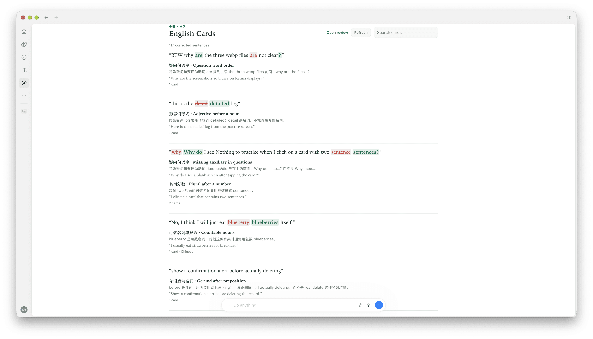

# Aoi Plugins

[小葵（Aoi）](https://aoilang.com) 的插件市场：为 Claude Code、ChatGPT/Codex 以及其他 MCP 客户端提供可移植的 [Agent Plugins](https://agent-plugins.org)。

## 插件

| 插件 | 适用 | 作用 |
| --- | --- | --- |
| [English Cards](plugins/english-cards/README.cn.md)（`aoi-grammar-cards`） | Claude Code、ChatGPT/Codex、Grok Bot、Cursor | 把对话里的英文语法问题变成复习卡片，并且保存到小葵账号里 |

## 预览



卡组在 ChatGPT 侧边栏展开。

## 安装

### Claude Code

```text
/plugin marketplace add aoilang/aoi-plugins
/plugin install aoi-grammar-cards@aoi-plugins
```

### ChatGPT 桌面端 / Codex

```bash
codex plugin marketplace add aoilang/aoi-plugins
```

重启 ChatGPT 桌面端，打开 Plugins Directory，选择 **Aoi Plugins**，安装 **English Cards**。Codex 也可以直接用命令行安装：

```bash
codex plugin add aoi-grammar-cards@aoi-plugins
```


### 直接安装插件目录

支持直接加载插件目录的客户端，可以指向 [`plugins/english-cards/`](plugins/english-cards/)。


## 许可

MIT — 见 [LICENSE](LICENSE)。
