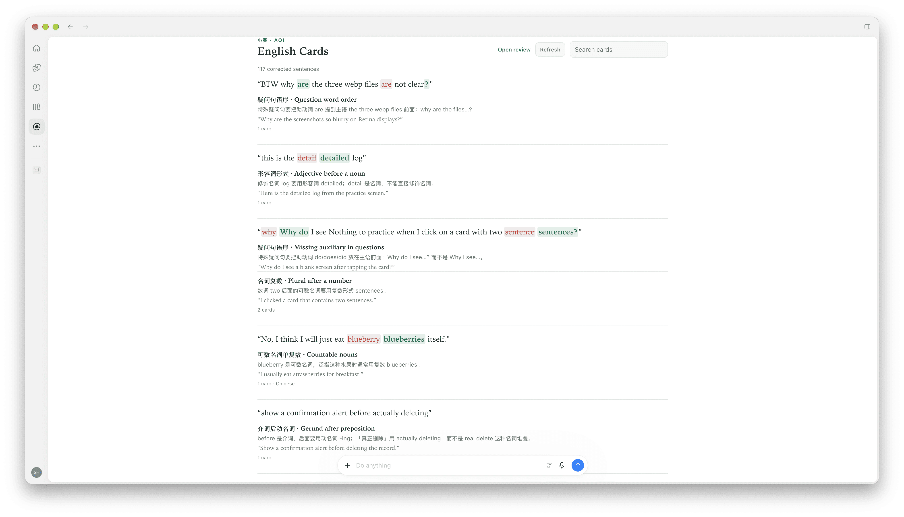

# Aoi Plugins

**English** | [中文](README.md)

A marketplace catalog for [小葵（Aoi）](https://aoilang.com) plugins — portable [Agent Plugins](https://agent-plugins.org) for Claude Code, ChatGPT/Codex, and other MCP hosts.

## Plugins

| Plugin | Best for | What it does |
| --- | --- | --- |
| [English Cards](plugins/english-cards/README.en.md) (`aoi-grammar-cards`) | Claude Code, ChatGPT/Codex, Grok Bot, Cursor | Automatically detects English grammar mistakes as you chat with your AI agent and saves them as review cards |

## Preview

All cards shown in the ChatGPT sidebar.




## Install

### Install automatically first — copy and paste into your AI agent

```text
Install the aoi-grammar-cards plugin from aoilang/aoi-plugins
```

### Claude Code

```text
/plugin marketplace add aoilang/aoi-plugins
/plugin install aoi-grammar-cards@aoi-plugins
```

### ChatGPT desktop / Codex

```bash
codex plugin marketplace add aoilang/aoi-plugins
codex plugin add aoi-grammar-cards@aoi-plugins
```

## MCP server

After installation the browser normally opens to complete OAuth verification. If it does not open, add the MCP server manually and complete the sign-in:

```text
https://aoilang.com/grammar/mcp/
```


## License

MIT — see [LICENSE](LICENSE).
