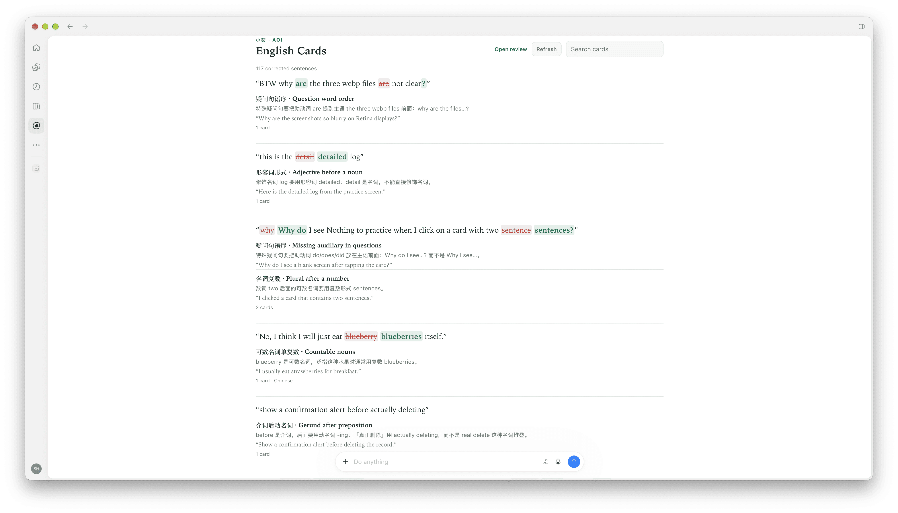

# Aoi Plugins

A marketplace catalog for [小葵（Aoi）](https://aoilang.com) plugins — portable [Agent Plugins](https://agent-plugins.org) for Claude Code, ChatGPT/Codex, and other MCP hosts.

## Plugins

| Plugin | Best for | What it does |
| --- | --- | --- |
| [English Cards](plugins/english-cards/README.md) (`aoi-grammar-cards`) | Claude Code, ChatGPT/Codex, Grok Bot, Cursor | Turns English grammar mistakes in chat into review cards saved to your Aoi account. |

## Preview



The deck opens in ChatGPT's sidebar.

## Install

### Claude Code

```text
/plugin marketplace add aoilang/aoi-plugins
/plugin install aoi-grammar-cards@aoi-plugins
```

### ChatGPT desktop / Codex

```bash
codex plugin marketplace add aoilang/aoi-plugins
```

Restart the ChatGPT desktop app, open the Plugins Directory, choose **Aoi Plugins**, and install **English Cards**. In Codex you can install from the CLI instead:

```bash
codex plugin add aoi-grammar-cards@aoi-plugins
```


### Direct folder install

Hosts that install a plugin folder directly can point at [`plugins/english-cards/`](plugins/english-cards/).


## License

MIT — see [LICENSE](LICENSE).
