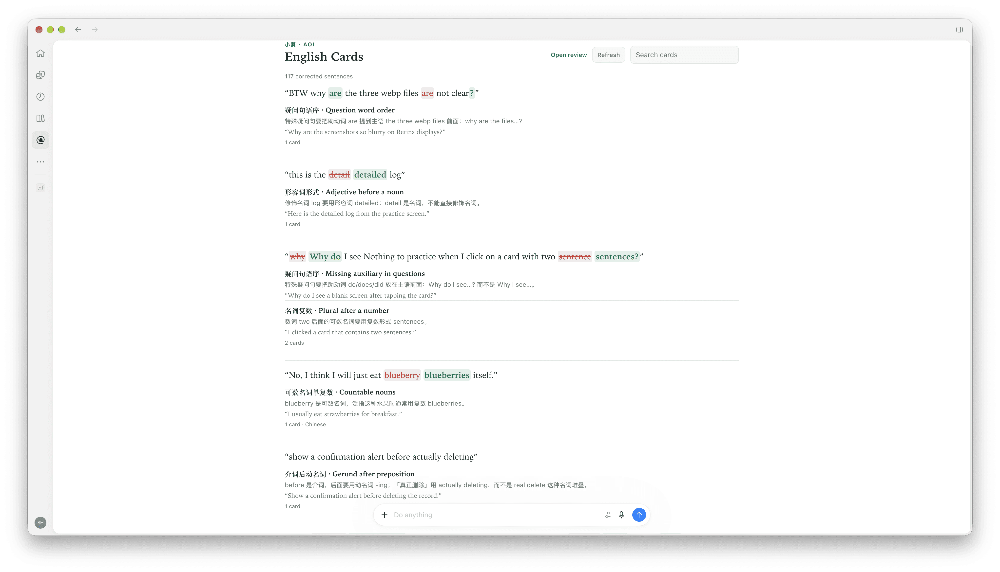

# Aoi Grammar Cards

**English** | [中文](README.md)

Want to improve your English? Then put your English to work. Talking to an agent is the best chance you get to use English: it fills most of our day, and it can understand expressions that are not quite accurate.

To encourage you to communicate in English more, the plugin detects grammar issues automatically: while the agent handles your other tasks, it finds grammar problems in your sentences, gives you instant feedback as you chat, and lets you learn from your own mistakes and feel your English improve.

As you chat in English, the agent notices issues and shows them in the conversation; where the agent supports it, a dedicated sidebar shows the cards from all conversations. Compatible with Claude Code, ChatGPT, Grok Bot, Cursor, and other [Agent Plugins](https://agent-plugins.org) / MCP hosts.

The MCP service is provided by [小葵（Aoi）](https://aoilang.com): grammar issues from different agents are saved together on your Aoi account, giving you richer practice.

## What you get

- **Auto-capture** — grammar issues worth learning become cards
- **Central page** — hosts that support MCP Apps get a searchable, reviewable UI
- **Synced to Aoi** — cards live on your Aoi account, sync across agents, and support richer practice

## Preview



## Install

You need a free [Aoi](https://aoilang.com) account. The first tool call opens OAuth so you can sign in.

### Install automatically first — copy and paste into your AI agent

```text
Install the aoi-grammar-cards plugin from aoilang/aoi-plugins
```

### Claude Code

```text
/plugin marketplace add aoilang/aoi-plugins
/plugin install aoi-grammar-cards@aoi-plugins
```

### ChatGPT desktop / Codex

```bash
codex plugin marketplace add aoilang/aoi-plugins
codex plugin add aoi-grammar-cards@aoi-plugins
```

## MCP server

After installation the browser normally opens to complete OAuth verification. If it does not open, add the MCP server manually and complete the sign-in:

```text
https://aoilang.com/grammar/mcp/
```


## Custom prompt

To make the agent check grammar proactively, paste this into the host's custom instructions / user rules (ChatGPT: **Settings → Personalization → Custom instructions**):

```text
Before you answer, check my English for clear grammar mistakes worth learning
(ignore typos and style). If you find any, call create_english_learning_cards
first with the corrections, then continue with my request. Do not call
show_english_learning_cards right after saving. If there is nothing to teach,
skip the grammar tools.
```

## Usage

Chat in English as usual. When there is something worth learning, the model saves cards and can open the deck. You can also ask:

- “Open my grammar cards.”
- “Review the English corrections from this chat.”
- “Save the grammar corrections from my last message.”

Review everything on the web anytime: [aoilang.com/grammar/review](https://aoilang.com/grammar/review/).


## License

MIT — see [LICENSE](LICENSE).
