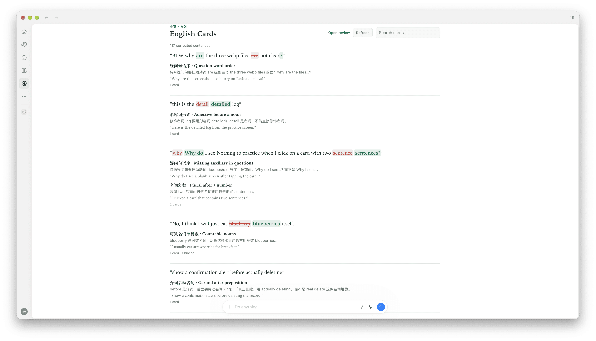

# 小葵语法卡片

**中文** | [English](README.en.md)

想提高英语吗？那就把你的英语用起来。和Agent交互是最好的使用英语的机会，它占据了我们大部分的日常时间，也能够理解我们不那么准确的表达。

为了激励你更多的使用英语沟通，插件提供自动识别语法问题功能，在Agent正常处理其他任务时，自动识别你句子里的语法问题，在用英语沟通时获得即时反馈，通过自己的错误来学习，切实感受到英语的提升。

用英文聊天时，Agent会自动发现问题，并在当前对话里展示，如果Agent支持，也会有一个专门的侧边栏展示所有对话中的卡片。可用于 Claude Code、ChatGPT、Grok Bot、Cursor 以及其他支持 [Agent Plugins](https://agent-plugins.org) / MCP 的客户端。

## 功能

- **自动收集** — 有学习价值的语法问题会变成卡片
- **集中页面** — 在支持 MCP Apps 的客户端里可以提供搜索、回顾UI
- **同步到小葵** — 卡片存在你的小葵账号，可以跨Agent同步，支持更丰富的练习

## 预览



## 安装

需要一个免费的 [小葵](https://aoilang.com) 账号。第一次调用工具时会弹出 OAuth，按提示登录即可。

### 优先自动安装，复制粘贴到你的AI Agent

```text
从 aoilang/aoi-plugins 安装 aoi-grammar-cards 插件
```

### Claude Code

```text
/plugin marketplace add aoilang/aoi-plugins
/plugin install aoi-grammar-cards@aoi-plugins
```

### ChatGPT 桌面端 / Codex

```bash
codex plugin marketplace add aoilang/aoi-plugins
codex plugin add aoi-grammar-cards@aoi-plugins
```

## MCP 服务器

MCP服务由[小葵（Aoi）](https://aoilang.com) 提供，默认安装完后会自动跳转到浏览器完成OAuth验证，如果没有跳转，需要手动添加MCP服务器，并完成登录验证。
MCP服务器地址：

```text
https://aoilang.com/grammar/mcp/
```


## 自定义prompt

为了让Agent主动的检查语法，可以把下面这段贴进客户端的自定义说明 / 用户规则（ChatGPT：**Settings → Personalization → Custom instructions**）：

```text
Before you answer, check my English for clear grammar mistakes worth learning
(ignore typos and style). If you find any, call create_english_learning_cards
first with the corrections, then continue with my request. Do not call
show_english_learning_cards right after saving. If there is nothing to teach,
skip the grammar tools.
```

## 使用

正常用英文对话即可。有值得学的语法点时，模型会保存卡片并可打开卡组。你也可以直接说：

- 「Open my grammar cards.」
- 「Review the English corrections from this chat.」
- 「Save the grammar corrections from my last message.」

随时在网页复习全部卡片：[aoilang.com/grammar/review](https://aoilang.com/grammar/review/)。


## 许可

MIT — 见 [LICENSE](LICENSE)。
